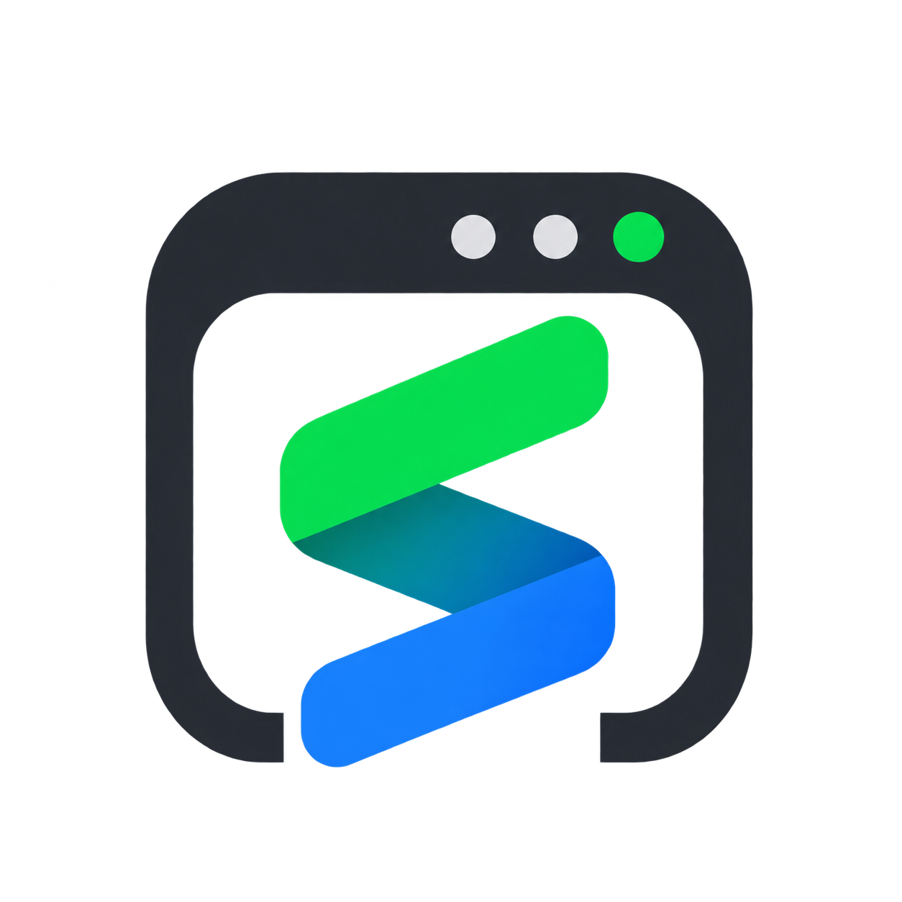
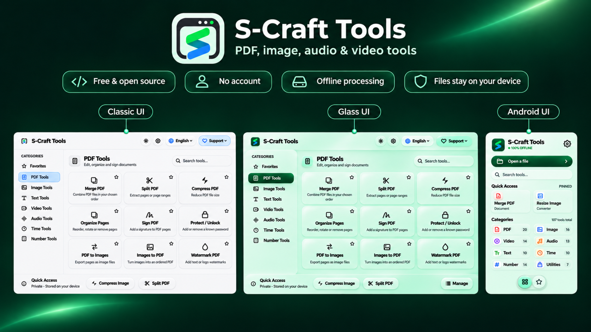
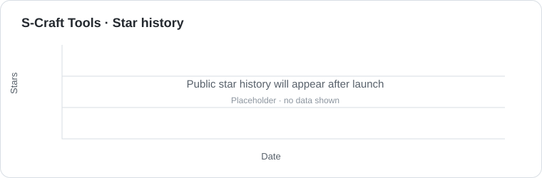

<p align="center"></p>

<h1 align="center">S-Craft Tools</h1>

<p align="center"><strong>Simple everyday tools. Your files stay on your device.</strong><br>PDF, image, audio, video, text, time and number tools.</p>

[](docs/assets/scraft-tools-hero-4k.png)

*Illustration of the Classic interface and proposed Glass and Android designs.*

## Download

| Platform | Status |
| --- | --- |
| Website | Awaiting launch |
| Android app | Coming soon |
| iOS app | Planned |

The website and future apps are not available to download from this table yet. See [Run locally from source](#run-locally-from-source) to try the current project.

---

## Overview

**S-Craft Tools** is an independent local web application providing fast, privacy-preserving file utilities across exactly seven primary categories:

1. **PDF Tools** — Edit, organize, merge, split, compress, watermark, protect, and visually sign PDF documents.
2. **Image Tools** — Exact width/height resizing, target-size compression, crop, convert, text/photo markup, watermarking, rotate/flip, image combining, signing, and metadata cleanup.
3. **Text Tools** — Word/character counts, case conversion, find/replace, cleanup, duplicate removal, sorting, random sample text, extraction, URL slugs, and text comparison.
4. **Video Tools** — Local trimming, compression, crop, resize, conversion, audio extraction, rotation, speed changes, clip merging, and mute.
5. **Audio Tools** — Local trimming, merging, conversion, video extraction, speed and volume controls, noise reduction, compression, fades, and looping.
6. **Time Tools** — Stopwatch, countdown, date difference and adjustment, timezone and timestamp conversion, duration conversion, age, Pomodoro, and business-day tools.
7. **Number Tools** — Calculator, percentages, units, EMI estimates, statistics, discounts, manual-rate currency conversion, ratios, number words, rounding, and base conversion.

---

## Privacy & Offline Architecture

- **Local processing:** The tools are designed to process files on your device. Representative browser workflows have been checked for unexpected network requests; the full privacy review is ongoing. External links such as Buy Me a Coffee open another website.
- **Strict Loopback Binding:** The server binds strictly to `127.0.0.1` (never exposed to external network interfaces).
- **Files:** The app is designed to process files without uploading them to a server. Browser downloads are saved where you choose; review the current release checks in [SAFETY.md](SAFETY.md).
- **Privacy-First Activity Log:** Existing Recent Activity data remains in browser `localStorage`. Favorites and Quick Access store stable tool IDs only, never filenames or file contents.
- **OCR availability:** Searchable OCR is unavailable until a local OCR engine and language data are installed. Its card reports this limitation instead of producing a non-searchable file and claiming success.

---

## Run locally from source

These steps start the app from the project source on your own computer and open its interface in a web browser. They do not install a separate desktop app. First download or clone this repository and extract it if needed. The repository must be public, or your GitHub account must have access, before you can download it.

### macOS

1. Install [Node.js](https://nodejs.org/en/download) version 20 or newer. The project has been tested with Node.js 24.21.0.
2. Install [FFmpeg](https://ffmpeg.org/download.html), including `ffmpeg` and `ffprobe`, and make sure both commands are available in your terminal. For example, if you already use [Homebrew](https://brew.sh/), run `brew install node ffmpeg`.
3. Open Terminal and go to the project folder. Replace the example path with your actual folder; keep the quotes if it contains spaces:

```bash
cd "/path/to/s-craft-tools"
```

4. Check the tools and start the app:

```bash
node --version
ffmpeg -version
ffprobe -version
npm start
```

5. Open [http://127.0.0.1:3300](http://127.0.0.1:3300) in your browser. Leave Terminal open while using the app. Press **Ctrl+C** in Terminal to stop it. If port 3300 is occupied, use the address printed by the server instead.

### Windows

**Windows has not been tested for this release.** The following steps are intended for local use, but individual features may need fixes. **Reveal in Finder** is a macOS-only feature.

1. Install [Node.js](https://nodejs.org/en/download) version 20 or newer using the Windows installer.
2. Download a Windows build of [FFmpeg](https://ffmpeg.org/download.html) that includes both `ffmpeg.exe` and `ffprobe.exe`. Extract it and add the folder containing those files (usually `bin`) to your Windows **Path** environment variable. Open a new Command Prompt after changing Path.
3. In Command Prompt, go to the project folder, replacing the example path with your actual folder:

```bat
cd /d "C:\path\to\s-craft-tools"
```

4. Check the tools and start the app:

```bat
node --version
ffmpeg -version
ffprobe -version
npm start
```

5. Open [http://127.0.0.1:3300](http://127.0.0.1:3300) in your browser. Leave Command Prompt open while using the app. Press **Ctrl+C** to stop it. If port 3300 is occupied, use the address printed by the server instead.

---

## Running Automated Tests

The automated tests cover selected image, PDF, utility and local media operations. They do not verify every browser, device, input, or feature:

Keep `npm start` running in another terminal before running the browser and media tests.

```bash
SCRAFT_PORTRAIT_FIXTURE=/path/to/test-portrait.png npm test
```

## Browser and GitHub Pages

Run `npm ci` and `npm run build:media`, then serve `public/` with a static HTTP server. The first media export downloads the bundled FFmpeg engine. Processing happens on the device. The browser accepts up to 100 MiB of input per job. Browser video merges normalize clips to 640 × 360. Large or complex media may need the local app.

For publishing and privacy checks, follow [SAFETY.md](SAFETY.md).

### Test Suite Highlights (48 / 48 PASS at the latest unit-suite run)

- **Exact Image Resize**: Verifies that setting independent Width=200 px and Height=230 px yields an exported raster image of exactly 200&times;230 pixels (checked via macOS `sips`).
- **Aspect Ratio Independence**: Unlocking aspect ratio guarantees that manually modifying height never alters width.
- **Target KB Compression**: Verified output file size is &le; 50 KB while preserving exact 200&times;230 dimensions.
- **Visual PDF & Image Signing**: Confirms coordinate translation and visible signature flattening.
- **PDF Operations**: Tests document creation, page rotation, page extraction, blank page insertion, multi-file merging, and watermarking.
- **Media Engine**: Tests local FFmpeg execution for video trimming, ordered merge, speed changes with and without audio, extraction, noise reduction, audio merge, and fades.
- **Pure Utilities**: Tests text generators/extractors/slugs, business-day logic, EMI calculations, manual-rate conversions, and existing date/number algorithms.
- **Browser suite**: Exercises all seven complete category grids, Favorites/Quick Access, image workflows and mobile layout, and existing PDF, video, and audio previews.

---

## File Structure

```text
S-Craft Tools/
├── package.json              # Project configuration & npm scripts
├── server.js                 # 127.0.0.1 local loopback server & media API
├── THIRD_PARTY_NOTICES.md    # Open-source licenses & legal attributions
├── README.md                 # Setup, launch, stop & usage instructions
├── SAFETY.md                 # Review and publishing instructions
├── android/                 # Android app — Coming soon (planned)
├── public/                  # Website
│   ├── index.html            # Approved responsive seven-category web app
│   ├── css/
│   │   └── style.css         # UI styles, tokens & dark mode
│   ├── js/
│   │   ├── app.js            # App router, Favorites, Quick Access, cards & tool views
│   │   ├── icons.js          # SVG outline icon system
│   │   ├── recent.js         # Privacy-first local activity history
│   │   ├── ui-utils.js       # Reusable dropzone, toast & canvas helpers
│   │   └── tools/
│   │       ├── image.js      # Exact resize, target KB, sign, crop, convert
│   │       ├── pdf.js        # Sign, merge, split, organize, watermark
│   │       ├── video.js      # Trim, compress, crop, resize, rotate, mute
│   │       ├── audio.js      # Trim, merge, loop, speed, volume, convert
│   │       ├── text.js       # Case, counter, find/replace, duplicates, sort
│   │       ├── time.js       # Stopwatch, chime timer, date diff, timezone
│   │       └── number.js     # Calculator, percent, units, stats, words
│   └── vendor/               # 100% offline bundled vendor scripts (No CDN)
│       ├── pdf-lib.min.js
│       ├── jszip.min.js
│       ├── browser-image-compression.js
│       ├── pdf.min.mjs
│       └── pdf.worker.min.mjs
└── test/
    ├── test-image-exact.js   # Exact 200x230 px and target KB tests
    ├── test-pdf-ops.js       # PDF operations & signing tests
    ├── test-utilities.js     # Text, time & number pure function tests
    ├── test-media-local.js   # Local loopback media tests
    └── run-all-tests.js      # Master test runner
```

---

## License

Project-owned code is licensed under **GNU Affero General Public License v3.0 only (AGPL-3.0-only)**. See [THIRD_PARTY_NOTICES.md](./THIRD_PARTY_NOTICES.md) for third-party licenses and the remaining provenance checks. The third-party review is not yet complete.

The website build generates the FFmpeg source package at `licenses/ffmpeg-core/source-bundle.zip` from the inputs in `sources/ffmpeg-core/`. The corresponding-source review and hosted delivery must be completed before publication.

## Translations and contributing

English is currently the only available interface language. To help translate, open a translation issue after the repository becomes public with the language, the English text, your translation and where it appears. Please keep placeholders and technical units intact. See the existing [contribution and translation guide](CONTRIBUTING.md).

To report a bug, include the device, browser, steps to reproduce and what you expected. To propose an improvement, describe the problem and your idea. Please use sample files rather than personal documents. After launch, use [GitHub Issues](https://github.com/s-creator01/s-craft-tools/issues) and link a pull request if you contribute a fix.

## Inspiration and third-party work

<details>
<summary>The projects that shaped S-Craft Tools</summary>

- [PDFCraft](https://github.com/PDFCraftTool/pdfcraft) — the bundled viewer includes confirmed PDFCraft files alongside PDF.js; its PDF processors were also reviewed as references.
- [Mazanoke](https://github.com/civilblur/mazanoke) — reviewed as an image-tool reference; the included image-compression library matches the separate MIT-licensed `browser-image-compression` distribution.
- [Omni Tools](https://github.com/iib0011/omni-tools) — recorded in the source audit as a reference for utility concepts.
- [ToolsForImage-OSS](https://github.com/mlbrothers/ToolsForImage-OSS) — recorded in the source audit as a reference for image-tool concepts.

</details>

The exact origin of some PDF and image functions is still being reviewed. Licenses, copyrights and the current findings are in [THIRD_PARTY_NOTICES.md](THIRD_PARTY_NOTICES.md).

## Support

If S-Craft Tools helps you, you can support its development with Buy Me a Coffee. The iOS app is planned and development has yet to start. Contributions can help cover the costs of getting the iOS version started.

[](https://buymeacoffee.com/screator01)

<a href="https://buymeacoffee.com/screator01"></a>

## Star history

This placeholder will be replaced with the date-based cumulative GitHub star chart when the repository is public.



[View star history after launch](https://star-history.com/#s-creator01/s-craft-tools&Date)

<!-- After the repository is public, replace the placeholder above with the token-free chart:
[](https://star-history.com/#s-creator01/s-craft-tools&Date)
-->
